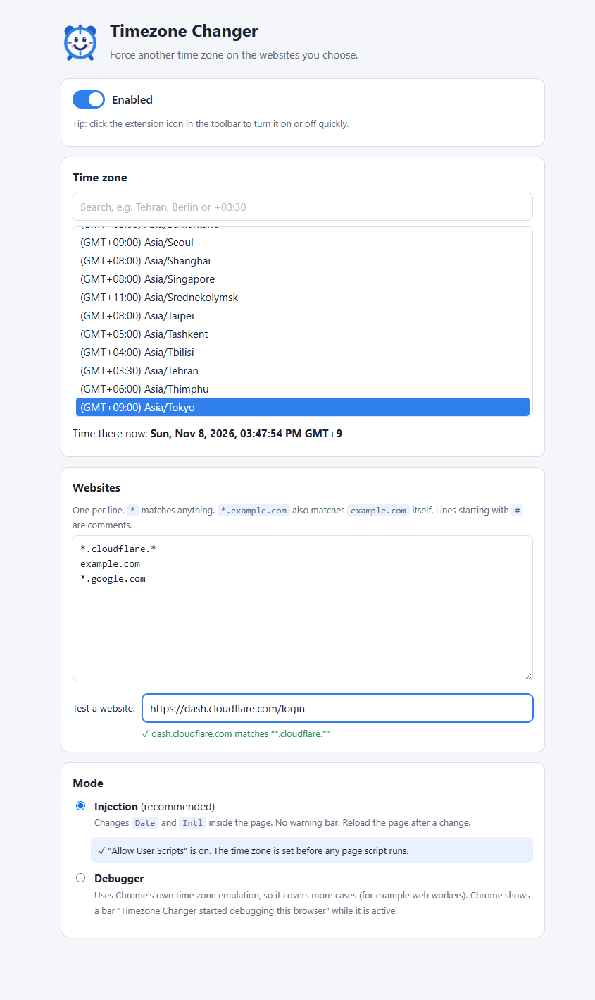

# Timezone Changer (Chrome extension)

 

Make chosen websites think your computer is in another time zone.
Other websites keep your real time zone.

- One **time zone** for all chosen sites (searchable list of all IANA zones).
- A **website list** with wildcards, for example `*.cloudflare.*`.
- **Click the toolbar icon** to turn it on (blue clock) or off (gray clock).
- Two **modes**: Injection (no warning bar) or Debugger (Chrome's own emulation).



## Install

1. Download `timezone-changer-<version>.zip` from the
   [latest release](https://github.com/fatehiman/timezone-changer-chrome-extension/releases/latest).
2. Unzip it.
3. Open `chrome://extensions` and turn on **Developer mode** (top right).
4. Click **Load unpacked** and choose the unzipped folder.
5. Open the extension **Details** and turn on **Allow User Scripts**
   (Chrome 138 and newer). See [Why "Allow User Scripts"?](#why-allow-user-scripts).
6. Pin the extension (puzzle icon > pin) so you can click it.

The settings page opens after install. Later: right-click the icon > **Options**.

## Settings

| Setting | What it does |
|---|---|
| Enabled | Turns the extension on or off. Same as clicking the toolbar icon. |
| Time zone | The time zone the chosen sites see. Type in the search box to filter (name or offset, e.g. `+03:30`). |
| Websites | One pattern per line (see below). |
| Test a website | Type a URL or host name to see if it matches the list. |
| Mode | Injection or Debugger (see below). |

Settings are saved at once. In Injection mode, **reload** open pages after a change.

### Website patterns

| Pattern | Matches | Does not match |
|---|---|---|
| `*.cloudflare.*` | `cloudflare.com`, `dash.cloudflare.com`, `a.b.cloudflare.net` | `xcloudflare.com` |
| `*.google.com` | `google.com`, `mail.google.com` | `google.de` |
| `example.com` | `example.com` only | `www.example.com` |
| `web.*.io` | `web.foo.io`, `web.a.b.io` | `web.io` |
| `*` | every site | – |

- `*` matches any characters, also dots.
- A leading `*.` also matches the bare domain (`*.cloudflare.*` matches `cloudflare.com`).
- You can paste full URLs: `https://foo.com:8080/path` becomes `foo.com`.
- Empty lines and lines starting with `#` are ignored.
- Upper / lower case does not matter.
- A frame inside a matching page (for example an embedded widget) gets the same time zone.

### Modes

| | Injection (recommended) | Debugger |
|---|---|---|
| How | Replaces `Date`, `Intl.DateTimeFormat` and `Temporal.Now` inside the page | Chrome DevTools `Emulation.setTimezoneOverride` |
| Warning bar | No | Yes: "Timezone Changer started debugging this browser" |
| Web workers | Not covered | Covered |
| Change applies | After page reload | At once, also in open tabs |
| Note | Needs "Allow User Scripts" for best results | If you press **Cancel** on the bar, it attaches again on the next page load |

#### Why "Allow User Scripts"?

The time zone must be changed **before** the page's own scripts run.

- With **Allow User Scripts** on, Chrome runs the extension's code first. This is reliable.
- With it off, the extension uses a **fallback** (`chrome.scripting`). The fallback often runs
  a moment **after** the first scripts in the page. Then a site may still see your real time
  zone in those first scripts. Later date calls are changed.

The settings page shows a warning when it is off.

## What is changed in Injection mode

- `new Date(...)` with local parts, `Date()`, `Date.parse` and date strings without a zone
- `getHours`, `getDate`, `getDay`, `getTimezoneOffset`, … and all local setters
- `toString`, `toDateString`, `toTimeString`, `toLocaleString`, `toLocaleDateString`, `toLocaleTimeString`
- `Intl.DateTimeFormat` (default time zone, so `resolvedOptions().timeZone` is the new zone)
- `Temporal.Now` (if the browser has it)
- Same-origin iframes (for example `about:blank`)
- Changed functions still look native (`Function.prototype.toString`)

DST rules come from Chrome's own time zone data, so summer / winter time is correct.

### Limits

- **Web workers** and service workers still see the real time zone in Injection mode. Use Debugger mode if this matters.
- The real time zone can still leak through things that are not time functions, for example
  your **IP address** or the `Accept-Language` header. This extension only changes the time zone.
- Pages like `chrome://…` and the Chrome Web Store cannot be changed (Chrome blocks all extensions there).

## Privacy

No data leaves your computer. There is no server, no analytics and no network request.
Settings are kept in `chrome.storage.local`.

## Permissions

| Permission | Why |
|---|---|
| `storage` | Keep your settings |
| `userScripts` | Run the time zone code before page scripts |
| `scripting`, `webNavigation` | Fallback injection, and find matching pages |
| `debugger` | Debugger mode only |
| `<all_urls>` | Your list can contain any site |

## Development

```
npm install        # only playwright-core, for the browser test
npm test           # unit test of the page script (compares with Node using a real TZ)
npm run e2e        # browser test: loads the extension in Playwright's Chromium
npm run icons      # draw the icons again (icons/*.png)
npm run zip        # build dist/timezone-changer-<version>.zip from the last commit
```

- `npm run e2e` needs a Chromium that still accepts `--load-extension`
  (Playwright's Chromium or Chrome for Testing; normal Chrome does not).
  Install it with `npx playwright install chromium`, or set `CHROMIUM_PATH`.
- `src/inject.js` is turned into a string and run inside the page. It must not use imports or outer variables.

### Files

| Path | What |
|---|---|
| `manifest.json` | Extension manifest (MV3) |
| `src/background.js` | Service worker: icon toggle, user script registration, fallback, debugger mode |
| `src/inject.js` | Page script that changes `Date` / `Intl` |
| `src/match.js` | Wildcard pattern rules |
| `src/settings.js` | Default settings, load / save |
| `src/options.*` | Settings page |
| `icons/` | Toolbar icons (blue = on, gray = off) |
| `tools/` | Tests, icon drawing, zip build (not in the release zip) |

## Release

1. Change `version` in `manifest.json` and `package.json`.
2. Commit and push.
3. `npm run zip`
4. `gh release create v<version> dist/timezone-changer-<version>.zip --title "v<version>" --notes "..."`

## License

MIT
